<div align="center">

# Sonia Nanwani

Computer Science Engineering @ WCE Sangli  
BS Data Science @ IIT Madras

<a href="https://linkedin.com/in/sonia-nanwani-8a8724329">LinkedIn</a> ·
<a href="https://github.com/Itssonia7">GitHub</a> ·
<a href="https://leetcode.com/u/itssonia7/">LeetCode</a> ·
<a href="https://www.codechef.com/users/its_sonia">CodeChef</a> ·
<a href="https://soniananwani.netlify.app">Portfolio</a>


</div>

---

### GitHub

<div align="center">

<table>
<tr>
<td>

</td>
<td>

</td>
</tr>
</table>

</div>

### LeetCode

<div align="center">

<a href="https://leetcode.com/u/itssonia7/">

</a>

</div>

### A Few Things I'm Proud Of

- Shortlisted for the IIT Bombay Research Internship – Compiler Optimizations based on Java Value Types.
- Selected for Amazon ML Summer School 2026 (among the top 3,000 from 1.34L+ applicants).
- Finalist, GDG Sangli TechSprint 2026 – EcoLens AI.
- Top 50, Breaking Enigma Hackathon 2026 – TrustTrace.
- CodeChef 2-Star Programmer; solved 850+ DSA problems across LeetCode and CodeChef.

---

### Background

**Education:** B.Tech CSE, Walchand College of Engineering (2024–2028)  
**Education:** BS Data Science, IIT Madras (2024–2028)

**Experience:** SDE Intern @ Pandit Bhandari & Co. | Former Web Development Intern @ IINFOKIDAA Solutions

**Skills:** C, C++, Java, Python, Go, SQL, Spring Boot, FastAPI, Django, React, PostgreSQL, Docker, Linux.

---

<div align="center">
<sub>Thanks for visiting!</sub>
</div>
```
